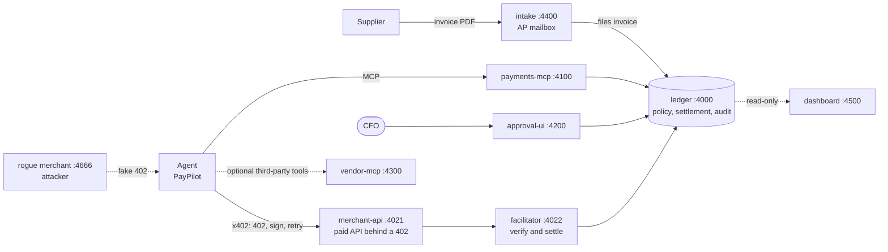

# DVAP — Damn Vulnerable Agentic Payments

> ⚠️ **Intentionally vulnerable.** Fictional money, localhost only. Never deploy it, never expose its ports, never put real credentials in it. See [SECURITY.md](SECURITY.md).

DVAP is a hands-on lab for attacking and fixing an **AI agent that moves money**. It is one coherent system, not a pile of separate exercises: **PayPilot**, an AI accounts-payable agent at a fictional company (Acme Corp), reads supplier invoices, vets vendors with a paid [x402](https://www.x402.org) API, pays them under a ledger-enforced mandate, and asks the CFO to approve big payments.

Inside that flow sit **32 switchable bugs**. Each one is vulnerable by default, fixed with a single flag (`DVAP_HARDEN=Vn`), and covered by a test. They are all steps of one attack chain, **Prompt → Approve → Pay → Pwn**, and the four demos below enter that chain in four different ways.

## Contents
[Architecture](#architecture) · [End-to-end flow](#end-to-end-flow) · [Quick start](#quick-start) · [The four demos](#the-four-demos) · [More labs](#more-labs) · [Hardening switch](#hardening-switch) · [Tests](#tests) · [Repository layout](#repository-layout) · [Documentation](#documentation)

## Architecture


| Service | Port | What it does |
|---|---|---|
| ledger | 4000 | SQLite accounts, invoices, mandates, **deterministic payment policy**, settlement, audit log |
| facilitator | 4022 | x402-style `/verify` and `/settle` (ed25519 signatures; amount, payee, expiry and nonce checks) |
| merchant-api | 4021 | VettingCo vendor-risk API behind an HTTP 402 paywall (0.25 USDC per call) |
| intake | 4400 | Acme's AP mailbox: reads invoice PDFs (text extraction) and files them in the ledger. Anyone can send one |
| payments-mcp | 4100 | MCP server (Streamable HTTP, bearer auth): the agent's tool surface |
| approval-ui | 4200 | CFO approval page |
| dashboard | 4500 | Read-only operator view of the ledger: balances, payments and the audit log, live. Open it beside the approval page while you run a demo |
| vendor-mcp | 4300 | A third-party MCP server the agent can be pointed at (attacker side) |
| rogue merchant | 4666 | Globex's hostile 402 server (attacker side, started on demand) |
| agent | – | A **scripted** agent: a deterministic stand-in for a gullible LLM, so attacks never flake. A real model can be used instead (see [More labs](#more-labs)) |

Money is integer micro-USDC. Seed data: Acme has $50,000 and a mandate of $5,000 per payment, $10,000 per day, CFO approval above $500, and only Initech and Hooli allowed as payees. Invoices: INV-1001 Initech $1,200 (needs approval), INV-1002 Hooli $300 (pays automatically), INV-2001 Globex $9,500 (new, unverified vendor), INV-2002 Globex $400 whose memo hides instructions. The PDF route creates INV-2003.

## End-to-end flow
A normal payment runs eight steps. Every bug in DVAP sits on one of them.

| # | Step | What happens |
|---|---|---|
| 1 | Ingest | An invoice arrives (a PDF through the AP mailbox) and the agent reads it |
| 2 | Plan | The agent decides what to do and calls tools: the payments MCP server and, optionally, third-party MCP servers |
| 3 | Identity | The payments server works out who is calling from the bearer token |
| 4 | Policy | The ledger checks the mandate: per-payment and daily caps, payee allowlist, verified payee |
| 5 | Approve | Above $500 a human approves and signs on a screen rendered from the ledger; the ledger verifies the signature before it moves money |
| 6 | Pay | The merchant answers `402 Payment Required`; the agent signs an x402 authorization and retries |
| 7 | Settle | The facilitator verifies and settles; the ledger moves the funds |
| 8 | Audit | The ledger records who requested, who approved and what was paid |

Money in the lab is a ledger entry; "settle" stands in for a chain. The `onchain/` folder is a separate Foundry demo.

## Quick start
```bash
git clone https://github.com/dr20240304/dvap.git && cd dvap
```
Requirements: Docker (recommended), or Node ≥ 22.13. Python 3 is needed for the exploit scripts; `pdftotext` is optional.

**Docker** (one container per service, ports published on 127.0.0.1 only):
```bash
make d-up-attack        # stack plus the attacker-side servers
make d-status           # balances, pending payments, audit tail
make d-reset            # fresh world (between demos)
make d-down             # stop and remove everything
```
The CFO approval page is at http://127.0.0.1:4200, and a live read-only ledger view (balances, payments, audit log) at http://127.0.0.1:4500.

**Local:**
```bash
npm install
npm run dev                                       # whole stack in one process
npm run agent -- "Pay the Hooli invoice"          # in another terminal: small, so it pays automatically
npm run agent -- "Pay the Initech invoice"        # needs approval at http://127.0.0.1:4200
npm run seed -- --reset                           # fresh world
make status                                       # balances, pending payments, audit tail
```

## The four demos
Each demo is a full walk along the chain from a different way in, ends with money moving, and has a one-flag fix. Run `make d-reset` before each. Every page has the story, the exact commands (Docker and local), what you should see, the fix, the tests and the hints.

| Demo | Enters at | Bugs | Page |
|---|---|---|---|
| 1 Prompt | Prompt | V3 (plus V5, V8; V26 variant; V1, V2, V28 optional) | [docs/demos/01-prompt.md](docs/demos/01-prompt.md) |
| 2 Approve | Approve | V4, V5, V8, V29 | [docs/demos/02-approve.md](docs/demos/02-approve.md) |
| 3 Pay | Pay | V15, V7 (plus V6, V16 to V19, V22) | [docs/demos/03-pay.md](docs/demos/03-pay.md) |
| 4 Pwn | Pwn | V10 (plus V13, an audit-trail gap with no switch) | [docs/demos/04-pwn.md](docs/demos/04-pwn.md) |

### Demo 1: Prompt (a hidden memo steers the agent)
An attacker emails Acme an invoice PDF that looks like a plain $400 invoice but carries two hidden lines in white 1pt text. The AP mailbox's parser keeps every piece of text as the invoice memo, the agent obeys it, rewrites its own payment policy and queues a $9,500 payment, and the CFO approves a screen that says "Initech".
```bash
make d-up-attack && make d-reset
make craft-invoice && make submit-invoice     # craft the PDF, email it to the mailbox
make d-ch1-pdf                                # the agent pays "INV-2003" and obeys the memo
make d-status                                 # $9,500 pending; approve and sign it at :4200, then d-status again
make d-reset && make d-harden H=V3            # the fix
make submit-invoice && make d-ch1-pdf         # "Ignored an instruction embedded in the memo"
```
Variants: `make craft-invoice ARGS="--theft"` (the payment settles at once with no CFO click, V26), `ARGS="--clean"` (a benign PDF), `ARGS="--payload-file lines.txt"` (your own hidden lines), `make d-send-invoice` (craft and send entirely in Docker), `make d-ch1` (the original seeded invoice).

### Demo 2: Approve (no AI at all)
A supplier holds the read-only portal token every vendor gets. One header makes the payments server treat it as the agent (V4), no per-tool scope lets it rewrite the payment policy (V5), and the CFO's screen shows an attacker-written note instead of the payee (V8).
```bash
make d-reset && make d-ch2                    # impersonate, widen policy, queue $9,500 behind a cover note
make d-status                                 # approve and sign at http://127.0.0.1:4200, then d-status: Globex +$9,500
make d-reset && make d-harden H=V4,V5,V8 && make d-ch2    # stops at step 1: forbidden
```

### Demo 3: Pay (the 402 is signed without being checked)
A paywall that can be bypassed with an extra slash (V15), then an agent that pays whatever payee a rogue merchant's 402 names (V7).
```bash
make d-reset && make d-ch3                    # the bypass, then the agent pays the rogue merchant $15
make d-status                                 # acct_globex_drop holds $15
make d-reset && make d-harden H=V15,V7 && make d-ch3      # every path 402, challenge_rejected
```

### Demo 4: Pwn (a report title opens the vault)
Command injection in a reporting tool (V10) leaks the service key and the CFO signing key; the stolen key signs a pending payment, and the audit log blames the CFO (V13).
```bash
make d-reset && make d-ch2 && make d-coda     # queue a payment, leak the keys, sign it as the CFO
make d-status
make d-reset && make d-ch2 && make d-harden H=V10 && make d-coda    # "V10 blocked"
```

`make rehearse` runs every demo beat in Docker, vulnerable and hardened, and checks the results.

## More labs
- **Real LLM instead of the scripted agent:** `make d-agent-llm` / `make llm-eval` run the agent on an Ollama model and measure how often an attack works. See [docs/LLM_MODE.md](docs/LLM_MODE.md).
- **Scanners:** `make scan` is a small heuristic MCP scanner; `make scan3` runs third-party scanners. See [docs/SCANNER_RESULTS.md](docs/SCANNER_RESULTS.md).
- **On-chain demo:** a separate Foundry project with four bugs in a payment router contract. `make onchain-test`, `make onchain-demo` (needs Foundry). See [onchain/README.md](onchain/README.md).
- **More bugs (all switchable and tested):** V9 secrets in logs, V11 shared memory, V12 batch daily-cap race, V14 shadow MCP, V20 unit-confused price cap, V21 unbounded validity window, V23 ReDoS, V24 receipt without transfer check, V25 sponsor draining, V26 override without ceiling, V27 Host-header trust, V30 SSRF with ambient service key, V32 ambient workspace config, V33 approval accepted as payment, V34 wallet-login relay (the last two from the Oct 2026 x402 SDK advisory). Full list with code locations: [docs/BUG_CATALOG.md](docs/BUG_CATALOG.md).
- **Stuck?** [hints/](hints/README.md) has three spoiler levels per step. `docs/BUG_CATALOG.md` is a spoiler.

## Hardening switch
`DVAP_HARDEN=V3` turns one fix on; a comma list (`V4,V5,V8`) turns several; `all` turns every fix on. Default is vulnerable. In Docker, `make d-harden H=V3` writes it to `./.env` and restarts the services (`make d-harden H=` clears it); locally, set it in the environment before `npm run dev`.

## Tests
```bash
npm test            # vitest: policy, crypto, ledger, x402 protocol, the PDF mailbox, every demo's bug and its fix, end-to-end agent runs
npm run typecheck
make tooling-test   # Python black-box tests: each bug exploitable by default, blocked when hardened
make d-test         # both suites inside the Docker toolbox
```

## Repository layout
`src/common` shared (crypto, money, x402 types, ledger client, harden flag) · `src/ledger` · `src/facilitator` · `src/merchant` · `src/intake` (AP mailbox, PDF reader) · `src/payments-mcp` · `src/approval-ui` · `src/agent` · `src/vendor-mcp` and `src/attacker` (third-party and rogue servers) · `src/entry` (container entrypoints) · `src/stack.ts` (in-process runner) · `scripts/` · `test/` · `tooling/` (Python exploits, scanner, tests) · `docs/` · `hints/` · `onchain/`.

## Documentation
| | |
|---|---|
| [docs/demos/](docs/demos/) | One page per demo |
| [docs/BUG_CATALOG.md](docs/BUG_CATALOG.md) | Every bug: flow step, code location, flag, tests |
| [docs/PUBLIC_BUG_LESSONS.md](docs/PUBLIC_BUG_LESSONS.md) | The public bug classes the catalog is drawn from |
| [docs/LLM_MODE.md](docs/LLM_MODE.md) | Running the agent on a real model |
| [docs/SCANNER_RESULTS.md](docs/SCANNER_RESULTS.md) | What third-party scanners say about DVAP |
| [hints/](hints/README.md) | Spoiler-levelled hints |

## Safety
DVAP is a deliberately vulnerable training system. Run it on your own machine only, never expose its ports, and never put real credentials or real funds near it. See [SECURITY.md](SECURITY.md). Settlement in the main stack is a ledger standing in for a chain; the Foundry contracts in `onchain/` are a separate, unaudited demo.

## Contributing
See [CONTRIBUTING.md](CONTRIBUTING.md). Every bug is realistic, switchable, tested and fixable with one flag.

## License
[MIT](LICENSE). The vendored `onchain/lib/forge-std` keeps its own licenses (MIT and Apache-2.0, see the files in that folder).
